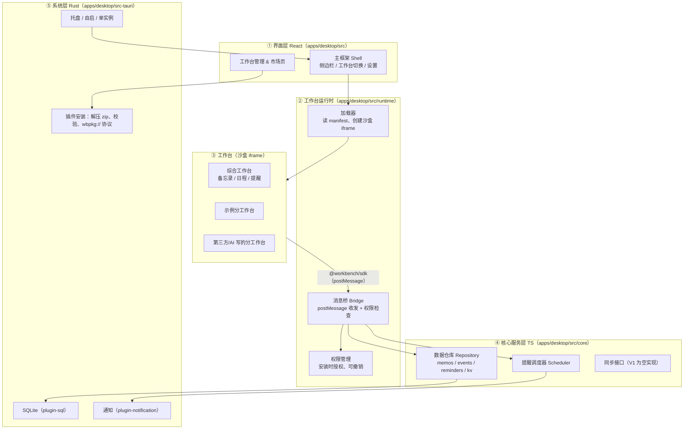
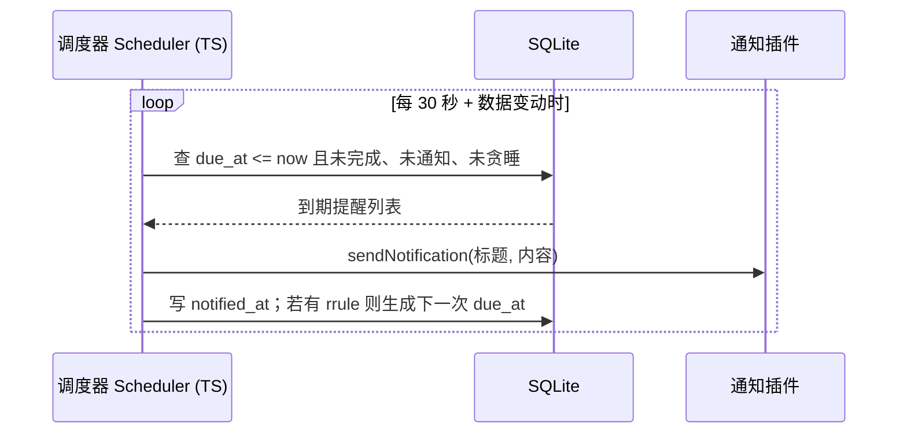

# WorkBench 工作台 · 架构与开发计划

> 本文件放在仓库根目录，是项目的"总说明书"。Codex 每次动手前都应先读它（`AGENTS.md` 会提醒它）。
> 版本：v0.2 · 2026-11-03 · 状态：框架已定，准备进入 Phase 0

---

## 0. 一句话结论

**用 Tauri 2 + React + TypeScript 做一个"主程序 + 插件"的工作台软件：数据本地优先存在 SQLite，每个分工作台都是放在沙盒 iframe 里的网页小模块，只能通过 `@workbench/sdk` 按权限访问主程序。先做 Windows，后面再加同步、线上市场、macOS 和手机端。项目开源，托管在 GitHub，用 MIT 协议。**

---

## 1. 产品概述与目标

| 项目 | 内容 |
|---|---|
| 产品 | WorkBench：模块化工作台软件 |
| 默认自带 | **综合工作台**：备忘录、日程安排、提醒事项 |
| 扩展方式 | **分工作台**，从**工作台市场**安装；用户可以上传自己写的或 AI 写的分工作台 |
| 平台顺序 | Windows → macOS → iOS / Android |
| 开发方式 | 主要由 Codex（Windows 桌面版）写代码，Royce 审核、运行、提交 |
| 预算 | 学生预算，优先免费方案 |

**V1 目标（Windows 可用版）**
1. 能安装、能开机自启、能常驻系统托盘
2. 综合工作台三件套好用：备忘录、日程、提醒（到点弹 Windows 通知）
3. 能从本地文件夹或 zip 安装分工作台，并附带一个示例分工作台
4. 数据结构从第一天起就为"以后多设备同步"做好准备

**V1 不做**：账号系统、云同步、线上市场、macOS/手机端、付费。

---

## 2. 技术栈（每项一句理由）

| 层 | 选型 | 理由 |
|---|---|---|
| 桌面/移动壳 | **Tauri 2** | 一套代码可打包 Windows/macOS/Linux/iOS/Android，安装包比 Electron 小很多 |
| 前端 | **React 18+ + TypeScript + Vite** | AI 最擅长、资料最多，类型检查能帮你提前发现错误 |
| UI | **Tailwind CSS + shadcn/ui** | 组件直接复制进项目，不用学复杂框架，好看又好改 |
| 状态管理 | **Zustand** | 比 Redux 简单得多，适合新手 |
| 本地数据库 | **SQLite**，通过 `tauri-plugin-sql`（sqlite 功能） | 官方插件，前端可直接执行 SQL，单文件数据库，备份方便 |
| 日期处理 | **dayjs**（+ `rrule` 处理重复规则） | 轻量，重复日程/提醒有成熟方案 |
| 包管理 | **pnpm workspaces**（monorepo） | 主程序、SDK、UI、分工作台放在一个仓库里统一管理 |
| 代码质量 | **ESLint + Prettier + Vitest** | 自动格式化和测试，让 Codex 写的代码保持一致 |
| Rust 部分 | 尽量少，只放系统能力 | 降低学习难度 |
| CI/发布 | **GitHub Actions + tauri-action** | 公开仓库免费，自动构建 Windows 安装包 |

**用到的 Tauri 2 官方插件（已于 2026-11 在 v2.tauri.app 核对，均支持 Windows）**

| 插件 | 用途 | 备注 |
|---|---|---|
| `tauri-plugin-sql` | SQLite 读写 | 需开启 `sqlite` feature |
| `tauri-plugin-notification` | 系统通知 | ⚠️ Windows 上**只有安装后的应用**才能正常显示；开发模式下会显示 PowerShell 的名字和图标，这是正常现象 |
| `tauri-plugin-fs` | 读写插件目录、导入导出 | 用权限 scope 限制可访问目录 |
| `tauri-plugin-dialog` | 选择文件夹/zip | |
| `tauri-plugin-autostart` | 开机自启 | 提醒功能依赖它 |
| `tauri-plugin-single-instance` | 防止重复启动 | 托盘应用必备 |
| `tauri-plugin-window-state` | 记住窗口大小位置 | |
| `tauri-plugin-updater` | 自动更新 | Phase 3 再加 |
| 系统托盘 | Tauri 核心自带（`tray-icon` feature） | 不是独立插件 |

> 注：官方插件当前要求 Rust ≥ 1.90，安装最新稳定版 Rust 即可。Tauri 2 正式支持 iOS 和 Android，移动端放 Phase 6。

---

## 3. 分层架构



**关键原则**
- 工作台**永远拿不到** Tauri API，也不能直接碰数据库；一切都经过 Bridge，Bridge 每次都检查权限。
- **综合工作台也走 SDK**（自己吃自己的狗粮）：这样插件接口一定是够用、经过检验的。如果某个功能实在做不了（比如复杂的系统托盘菜单），允许它通过"内置专属权限"访问，但要在代码里注明原因。
- 业务逻辑尽量写在 TypeScript（④），Rust（⑤）只做系统能力。

---

## 4. 仓库目录结构（pnpm monorepo）

```text
workbench/
├─ AGENTS.md                 # 给 Codex 的规则（简短）
├─ ARCHITECTURE.md           # 本文件
├─ README.md / LICENSE / CONTRIBUTING.md / CHANGELOG.md
├─ .gitignore  .editorconfig  .prettierrc  eslint.config.js
├─ package.json              # 根脚本：dev / build / lint / test
├─ pnpm-workspace.yaml       # packages: apps/*, packages/*, workbenches/*
├─ .github/
│  ├─ workflows/ci.yml       # lint + 类型检查 + 测试 + Windows 构建
│  ├─ workflows/release.yml  # 打 tag 时发布安装包（Phase 3）
│  ├─ ISSUE_TEMPLATE/        # bug / 功能建议 / 提交分工作台
│  └─ pull_request_template.md
├─ apps/
│  └─ desktop/               # Tauri 主程序
│     ├─ src/                # React 前端
│     │  ├─ shell/           # 主框架：布局、侧边栏、设置页
│     │  ├─ runtime/         # 加载器、Bridge、权限
│     │  ├─ core/            # db/、repositories/、scheduler/、sync/
│     │  └─ main.tsx
│     └─ src-tauri/          # Rust：托盘、插件安装、自定义协议
│        ├─ src/lib.rs
│        ├─ capabilities/    # Tauri 权限配置
│        ├─ migrations/      # SQL 迁移文件 0001_init.sql ...
│        └─ tauri.conf.json
├─ packages/
│  ├─ sdk/                   # @workbench/sdk：分工作台使用的 API
│  ├─ ui/                    # @workbench/ui：共享 React 组件和主题
│  ├─ manifest/              # manifest 的类型定义和校验（zod）
│  └─ create-workbench/      # （后期）脚手架：一条命令生成分工作台模板
├─ workbenches/
│  ├─ general/               # 综合工作台（内置）
│  └─ sample-pomodoro/       # 示例分工作台：番茄钟
└─ docs/                     # 插件开发指南、设计稿等
```

---

## 5. 数据模型（SQLite）

**每张业务表都必须有这 5 个字段（为同步做准备）：**

| 字段 | 类型 | 说明 |
|---|---|---|
| `id` | TEXT PK | UUID v7（按时间有序，前端生成） |
| `created_at` | INTEGER | Unix 毫秒 |
| `updated_at` | INTEGER | Unix 毫秒，每次修改都要更新 |
| `deleted_at` | INTEGER NULL | 软删除（墓碑），**禁止真删除**；查询默认过滤 `deleted_at IS NULL` |
| `device_id` | TEXT | 最后修改的设备 ID（首次启动生成，存在 settings） |

```sql
-- 0001_init.sql
CREATE TABLE memos (
  id TEXT PRIMARY KEY, created_at INTEGER NOT NULL, updated_at INTEGER NOT NULL,
  deleted_at INTEGER, device_id TEXT NOT NULL,
  deletion_group_id TEXT, purged_at INTEGER, -- 联动删除分组、已清空内容标记
  title TEXT NOT NULL DEFAULT '',
  content TEXT NOT NULL DEFAULT '',        -- Markdown
  pinned INTEGER NOT NULL DEFAULT 0,
  tags TEXT NOT NULL DEFAULT '[]'          -- JSON 数组
);

CREATE TABLE events (                       -- 日程
  id TEXT PRIMARY KEY, created_at INTEGER NOT NULL, updated_at INTEGER NOT NULL,
  deleted_at INTEGER, device_id TEXT NOT NULL,
  deletion_group_id TEXT, purged_at INTEGER,
  title TEXT NOT NULL,
  notes TEXT NOT NULL DEFAULT '',
  start_at INTEGER NOT NULL,
  end_at INTEGER NOT NULL,
  all_day INTEGER NOT NULL DEFAULT 0,
  timezone TEXT NOT NULL DEFAULT 'Asia/Shanghai',
  rrule TEXT,                               -- 重复规则（RFC 5545），NULL 表示不重复
  color TEXT,
  source_workbench TEXT,                    -- 由哪个工作台创建
  exdates TEXT NOT NULL DEFAULT '[]',        -- 原实例开始时间（毫秒）数组
  recurrence_id TEXT REFERENCES events(id),
  original_start_at INTEGER,
  remind_before_minutes INTEGER             -- NULL = 不提醒，0 = 准时
);

CREATE TABLE reminders (                    -- 提醒事项
  id TEXT PRIMARY KEY, created_at INTEGER NOT NULL, updated_at INTEGER NOT NULL,
  deleted_at INTEGER, device_id TEXT NOT NULL,
  deletion_group_id TEXT, purged_at INTEGER,
  title TEXT NOT NULL,
  notes TEXT NOT NULL DEFAULT '',
  due_at INTEGER,                           -- 到点时间，NULL 表示只是待办
  rrule TEXT,
  completed_at INTEGER,
  notified_at INTEGER,                      -- 已通知时间，防止重复弹
  snooze_until INTEGER,
  priority INTEGER NOT NULL DEFAULT 0,
  event_id TEXT,                            -- 可关联日程
  source_workbench TEXT,
  source TEXT NOT NULL DEFAULT 'manual'      -- manual / event
);
CREATE INDEX idx_events_range ON events(start_at, end_at) WHERE deleted_at IS NULL;
CREATE INDEX idx_reminders_event ON reminders(event_id) WHERE deleted_at IS NULL;
CREATE UNIQUE INDEX idx_events_exception ON events(recurrence_id, original_start_at)
  WHERE recurrence_id IS NOT NULL AND deleted_at IS NULL;
CREATE INDEX idx_reminders_due ON reminders(due_at) WHERE deleted_at IS NULL AND completed_at IS NULL;

CREATE TABLE installed_workbenches (
  id TEXT PRIMARY KEY,                      -- = manifest.id，如 com.royce.pomodoro
  created_at INTEGER NOT NULL, updated_at INTEGER NOT NULL,
  deleted_at INTEGER, device_id TEXT NOT NULL,
  name TEXT NOT NULL,
  version TEXT NOT NULL,
  manifest TEXT NOT NULL,                   -- 完整 manifest JSON
  granted_permissions TEXT NOT NULL DEFAULT '[]',
  enabled INTEGER NOT NULL DEFAULT 1,
  builtin INTEGER NOT NULL DEFAULT 0,
  install_path TEXT NOT NULL,
  sort_order INTEGER NOT NULL DEFAULT 0
);

CREATE TABLE workbench_kv (                 -- 每个工作台自己的存储空间
  id TEXT PRIMARY KEY, created_at INTEGER NOT NULL, updated_at INTEGER NOT NULL,
  deleted_at INTEGER, device_id TEXT NOT NULL,
  workbench_id TEXT NOT NULL,
  key TEXT NOT NULL,
  value TEXT NOT NULL,                      -- JSON
  UNIQUE (workbench_id, key)
);

CREATE TABLE settings (
  id TEXT PRIMARY KEY, created_at INTEGER NOT NULL, updated_at INTEGER NOT NULL,
  deleted_at INTEGER, device_id TEXT NOT NULL,
  deletion_group_id TEXT, purged_at INTEGER,
  key TEXT NOT NULL UNIQUE,
  value TEXT NOT NULL                       -- JSON
);
-- 本地专用：sync_state / migrations 记录等，不参与同步
```

**规则**
- 综合工作台以 `docs/specs/general-workbench.md` §8、§10 补充本节；可执行约束以 `apps/desktop/src-tauri/migrations/0001_init.sql` 为准。
- `memos`、`events`、`reminders`、`settings` 使用 `deletion_group_id` 标识一次联动删除，使用 `purged_at` 区分可恢复记录和已清空内容的墓碑；永久清空不删除行，也不清除 `deleted_at`。
- `settings` 继续按唯一 `key` 读写 JSON，同时带完整元数据；`device_id` 首次生成后保持不变，`last_trash_purge_at` 与清理操作在同一事务中写入。
- 数据库使用 SQL 插件预加载和版本迁移；Windows 路径为 `%APPDATA%/com.royce.workbench/workbench.db`。联动写入通过插件连接池的通用事务适配执行，业务逻辑仍在 TypeScript。
- 改表结构只能**新增迁移文件**（`0002_xxx.sql`），不能改已发布的旧迁移。
- 所有读写都通过 `core/repositories/*`，界面和工作台不直接写 SQL。
- 单个工作台的 kv 设上限（如 10 MB），防止滥用。

---

## 6. 分工作台（插件）规范

### 6.1 包格式
一个分工作台 = 一个文件夹（或其 zip，扩展名可用 `.wbpkg`），根目录必须有 `manifest.json`，前端是**已构建好的静态文件**（HTML/JS/CSS），不允许运行原生代码。

```json
{
  "id": "com.royce.pomodoro",
  "name": "番茄钟",
  "version": "1.0.0",
  "author": { "name": "Royce", "url": "https://github.com/royce" },
  "description": "简单的番茄钟，完成后发通知",
  "entry": "index.html",
  "icon": "icon.png",
  "minHostVersion": "0.1.0",
  "permissions": ["storage", "notifications", "reminders:write"],
  "license": "MIT",
  "homepage": "https://github.com/royce/workbench-pomodoro"
}
```

校验规则：`id` 为反向域名格式且全局唯一；`version` 为 semver；`entry` 必须在包内；未知权限直接拒绝安装。

### 6.2 SDK API（`@workbench/sdk`）

所有方法都是 `async`，底层用 `postMessage` + 请求 ID 实现。

| 模块 | 方法 | 需要的权限 |
|---|---|---|
| `wb.app` | `getInfo()`、`getTheme()`、`onThemeChange(cb)`、`getLocale()` | 无 |
| `wb.storage` | `get(key)`、`set(key, value)`、`remove(key)`、`list(prefix?)` | `storage`（只能访问本工作台自己的空间） |
| `wb.notifications` | `send({ title, body })` | `notifications` |
| `wb.reminders` | `list(filter)`、`create()`、`update()`、`complete()` | `reminders:read` / `reminders:write` |
| `wb.calendar` | `listEvents(range)` / `createEvent()`、`updateEvent()` | `calendar:read` / `calendar:write` |
| `wb.memos` | `list()`、`get()` / `create()`、`update()` | `memos:read` / `memos:write` |
| `wb.ui` | `toast(msg)`、`confirm(msg)`、`setTitle(t)`、`setBadge(n)` | 无 |
| `wb.events` | `on('data-changed', cb)` | 跟随对应读权限 |
| `wb.net` | `fetch(url)`（后期，按域名白名单） | `net:<域名>` |

> 删除类操作一律是软删除；工作台只能修改自己创建的数据（`source_workbench` 判断），除非获得 `*:write-all`（V1 不开放）。

### 6.3 安全与权限模型
1. **沙盒**：`<iframe sandbox="allow-scripts allow-forms">`，**不加** `allow-same-origin`、`allow-top-navigation`、`allow-popups-to-escape-sandbox`。
2. **独立来源**：工作台文件通过 Rust 注册的自定义协议 `wbpkg://<id>/...` 提供，不同工作台互相隔离，且该来源**不授予任何 Tauri capability**。
3. **CSP**：工作台页面默认 `default-src 'self' wbpkg:; connect-src 'none'`，没有 `net` 权限就无法联网。
4. **Bridge 校验**：每条消息检查 `event.source` 对应哪个 iframe → 查该工作台已授权权限 → 校验参数（zod）→ 执行。永远不信任消息里自报的 id。
5. **授权流程**：安装时弹窗列出权限，用户同意才安装；设置页可随时撤销。
6. **限流**：通知、写入等接口限频，防止刷屏。
7. **线上市场阶段**再加：包签名、哈希校验、人工/自动审核。

---

## 7. 提醒与通知机制（Windows）

**结论：应用必须常驻系统托盘，提醒才会准时触发。** Tauri 的通知插件在桌面端只负责"立即弹出"，定时靠我们自己的调度器。



- **关窗口 = 隐藏到托盘**，不是退出；托盘菜单有"打开 / 新建提醒 / 退出"。
- 开启 `autostart`（默认开、可关）+ `single-instance`。
- **补发**：启动时检查"关机期间错过的提醒"，合并成一条"你有 N 条错过的提醒"。
- 用 `setTimeout` 精确对准下一个到期时间，再用 30 秒轮询兜底（电脑睡眠唤醒后计时器可能不准）。
- ⚠️ 开发模式（`pnpm tauri dev`）下通知会显示 PowerShell 图标；**要测真实效果需先打包安装**（Phase 3 前可用 `pnpm tauri build` 装一次）。
- 以后（Phase 6）手机端改用系统级定时通知，桌面逻辑不变。

---

## 8. 同步预留（Phase 4 才做）
- V1 只在 `core/sync/` 放一个接口 `SyncProvider { push(), pull() }` 和空实现。
- 候选方案：**Supabase**（免费额度、Postgres、最省事，"最后写入者胜"按 `updated_at`）或 **CRDT**（如 Automerge/Yjs，冲突自动合并，复杂度高）。推荐先 Supabase + LWW，备忘录正文冲突时保留两份。
- 因为所有表都有 UUID、时间戳、墓碑和 device_id，加同步时**不用改表**。

---

## 9. 开源与 GitHub

### 9.1 许可证：选 **MIT**
| 选项 | 优点 | 缺点 |
|---|---|---|
| **MIT ✅** | 最简单、最常见；别人写分工作台、二次开发没有顾虑，利于市场生态 | 别人可闭源商用你的代码 |
| Apache-2.0 | 多了专利授权条款，更"正式" | 文本长、要求保留 NOTICE，对新手偏繁琐 |
| GPL-3.0 | 强制衍生作品也开源 | 会吓退插件作者和潜在合作者，和"市场"方向冲突 |

理由：你是学生个人项目，目标是生态和作品集，MIT 门槛最低。分工作台作者可自选许可证（manifest 里写 `license`）。以后若担心专利问题，可改为 MIT/Apache-2.0 双许可。

### 9.2 新手 Git 工作流（够用就好）
- **`main` 分支永远能运行**，不直接在 main 上写功能。
- 每个功能开一个分支：`feat/memo-editor`、`fix/reminder-repeat`、`docs/readme`。
- 小步提交，提交信息用 **Conventional Commits**：
  - `feat: 备忘录支持置顶` · `fix: 修复重复提醒重复弹出` · `docs:` · `refactor:` · `test:` · `chore:` · `ci:`
  - 可加范围：`feat(reminders): 支持贪睡 10 分钟`
- 完成后推到 GitHub → 开 **Pull Request** → 等 CI 变绿 → 自己检查一遍 diff → **Squash and merge** → 删除分支。
- 每完成一个阶段打一个标签：`v0.1.0`、`v0.2.0`（语义化版本）。

日常命令（每次只需这几条）：
```bash
git switch main && git pull           # 从最新的 main 开始
git switch -c feat/memo-editor        # 开新分支
# ……让 Codex 写代码，自己运行确认……
git add -A && git commit -m "feat(memos): 新增备忘录编辑器"
git push -u origin feat/memo-editor   # 然后去 GitHub 开 PR
```
> 让 Codex 帮你写提交信息也可以，但**提交前一定自己运行一遍**。

### 9.3 GitHub 仓库设置清单
- [ ] 新建公开仓库 `workbench`（不勾选自动生成 README，我们本地已有）
- [ ] 必备文件：`README.md`（截图、功能、安装、开发方式）、`LICENSE`（MIT）、`CONTRIBUTING.md`（如何开发、提交规范、PR 流程）、`CHANGELOG.md`
- [ ] `.github/ISSUE_TEMPLATE/`：`bug_report.yml`、`feature_request.yml`、`submit_workbench.yml`
- [ ] `.github/pull_request_template.md`：改了什么、怎么测试、截图、勾选"已本地运行"
- [ ] **分支保护**：main 必须通过 PR 合并、CI 必须通过（Settings → Branches/Rulesets）
- [ ] 打开 Dependabot（依赖安全提醒，免费）
- [ ] 启用 Discussions（可选，收集想法）

### 9.4 GitHub Actions
**`ci.yml`（每次 push / PR）**，在 `windows-latest` 上运行（公开仓库免费）：
1. checkout → 安装 pnpm、Node LTS（带缓存）→ 安装 Rust stable（`Swatinem/rust-cache` 缓存）
2. `pnpm install --frozen-lockfile`
3. `pnpm lint` → `pnpm typecheck` → `pnpm test`
4. `pnpm --filter desktop tauri build --no-bundle`（只验证能编译，节省时间）

**`release.yml`（Phase 3，推送 `v*` 标签时）**：用官方 `tauri-apps/tauri-action` 构建 Windows 安装包（NSIS `.exe` / `.msi`），自动创建 GitHub Release 草稿并上传安装包，配合 `tauri-plugin-updater` 的签名密钥（存在仓库 Secrets，**绝不提交到仓库**）。

### 9.5 早期市场：用 GitHub 收分工作台
在线市场做好之前（Phase 5 前），用一个单独的公开仓库 **`workbench-registry`** 充当市场：
1. 作者在自己的仓库开发分工作台，在 GitHub Release 里上传 `.wbpkg`（zip）。
2. 作者向 `workbench-registry` 提 PR，新增一个文件 `workbenches/com.xxx.yyy.json`（内容：manifest 摘要 + 下载链接 + SHA-256 哈希 + 源码仓库地址），或用 `submit_workbench` issue 模板提交。
3. registry 的 CI 自动检查：manifest 格式、id 不重复、权限是否合理、下载链接可用、哈希一致。
4. Royce 人工看一眼源码后合并。
5. CI 把所有条目合并成一个 `index.json`，通过 GitHub Pages 免费发布。
6. 主程序的"市场"页读取这个 `index.json`，下载 → 校验哈希 → 走本地安装流程（和 V1 的 zip 安装复用同一套代码）。

好处：零服务器成本、公开透明、审核流程天然就是 PR Review。

---

## 10. 分阶段路线图

| 阶段 | 目标 | 里程碑（完成标准） | 预计 |
|---|---|---|---|
| **Phase 0** 环境 | Windows 开发环境 + 仓库骨架 + GitHub | `pnpm tauri dev` 能打开空窗口；代码已推到 GitHub 且 CI 绿 | 1–3 天 |
| **Phase 1** 主框架 + 综合工作台 | 主界面、SQLite、三件套、托盘、提醒 | 能增删改查备忘录/日程/提醒，关窗进托盘，到点弹通知 | 2–4 周 |
| **Phase 2** 插件运行时 | SDK、沙盒、权限、本地安装、示例分工作台 | 从 zip 装上"番茄钟"，它能存数据、发通知；综合工作台迁到 SDK 上 | 2–4 周 |
| **Phase 3** 打磨 + 打包 | 设置、主题、备份导出、安装包、自动更新 | GitHub Release 发布 v0.3.0 安装包，别人能下载安装 | 1–2 周 |
| **Phase 4** 同步 | 账号 + Supabase 同步 | 两台 Windows 电脑数据互通 | 3–4 周 |
| **Phase 5** 线上市场 | registry → 市场页 → 签名/审核 | 在 App 内浏览、安装、更新社区工作台 | 3–4 周 |
| **Phase 6** 多平台 | macOS → Android → iOS | 各平台能运行综合工作台并同步 | 视情况 |

> 时间按"每天 1–2 小时、主要靠 Codex"估算，仅供参考。**每个阶段完成都打 tag 并写 CHANGELOG。**

### Phase 0：环境准备（Windows）
手动安装（按顺序）：
1. **Git for Windows**（安装时保持默认；装完运行 `git config --global user.name "你的名字"` 和 `git config --global user.email "你的GitHub邮箱"`）
2. **Microsoft C++ Build Tools**（Visual Studio Build Tools，勾选"使用 C++ 的桌面开发"）
3. **WebView2**（Windows 10/11 一般已自带，确认即可）
4. **Rust**（官网 rustup-init.exe，默认 MSVC 工具链；装完 `rustup update`）
5. **Node.js LTS**，然后 `corepack enable` 启用 **pnpm**
6. **GitHub 账号** + 安装 **GitHub CLI**（`winget install GitHub.cli`，然后 `gh auth login`）
7. 验证：`git --version`、`node -v`、`pnpm -v`、`rustc -V`、`cargo -V`、`gh --version`

Git 初始化与首次推送：
```bash
cd D:\code\workbench            # 放 ARCHITECTURE.md / AGENTS.md / .gitignore 的目录
git init -b main
git add -A
git commit -m "chore: 初始化项目文档与配置"
gh repo create workbench --public --source . --remote origin --push
# 不用 gh 的话：在 GitHub 网页建空仓库，然后
# git remote add origin https://github.com/<你的用户名>/workbench.git
# git push -u origin main
```

**Codex 提示词（Phase 0）**
```text
请先阅读仓库根目录的 ARCHITECTURE.md 和 AGENTS.md。我在 Windows 上，已经安装了 Git、Node LTS、pnpm、Rust、VS C++ Build Tools，并已执行 git init 且推送到 GitHub。
任务：按 ARCHITECTURE.md 第 4 节搭建 pnpm monorepo 骨架。
1. 新建分支 chore/scaffold。
2. 根目录：package.json（scripts: dev, build, lint, typecheck, test, format）、pnpm-workspace.yaml、.editorconfig、.prettierrc、eslint.config.js、tsconfig.base.json；保留现有 .gitignore。
3. 用 Tauri 2 官方模板（React + TypeScript + Vite）在 apps/desktop 创建主程序，productName 为 WorkBench，identifier 为 com.royce.workbench。
4. 建立空包 packages/sdk、packages/ui、packages/manifest，以及 workbenches/general（各有 package.json、src/index.ts、README）。
5. 添加 LICENSE（MIT，作者 Royce Lee，2026）、README.md（中文，含项目简介和开发命令）、CONTRIBUTING.md（第 9.2 节的分支和提交规范）、.github/ISSUE_TEMPLATE（bug_report、feature_request、submit_workbench）、.github/pull_request_template.md。
6. 添加 .github/workflows/ci.yml：windows-latest，pnpm + Node LTS + Rust stable（带缓存），依次运行 pnpm install --frozen-lockfile、lint、typecheck、test、以及 apps/desktop 的 tauri build --no-bundle。
7. 确保 `pnpm install`、`pnpm lint`、`pnpm typecheck` 和 `pnpm --filter desktop tauri dev` 都能成功。
8. 按 Conventional Commits 分几次小提交，最后告诉我：要运行哪些命令验证、怎么推送分支并在 GitHub 开 PR。
不要添加文档以外的功能。遇到需要我手动安装或操作的事情，停下来列清楚步骤。
```

### Phase 1：主框架 + 综合工作台
**Codex 提示词（Phase 1，可拆成 3 次发）**
```text
请先阅读 ARCHITECTURE.md（重点第 3、5、7 节）和 AGENTS.md。新建分支 feat/general-workbench。
第一步（数据层）：
- 在 apps/desktop 接入 tauri-plugin-sql（sqlite），数据库文件 workbench.db 放在应用数据目录。
- 按第 5 节写 migrations/0001_init.sql，并在启动时自动执行迁移。
- 首次启动生成 device_id 存入 settings。
- 在 src/core/repositories 下实现 memos、events、reminders、settings 的仓库：统一用 UUID v7、毫秒时间戳、软删除，查询默认排除已删除。为每个仓库写 Vitest 单元测试。
第二步（界面）：
- 用 Tailwind + shadcn/ui 做主框架：左侧工作台侧边栏、顶部标题、内容区、设置页；支持浅色/深色主题。
- 在 workbenches/general 实现综合工作台三个页签：备忘录（列表+Markdown 编辑、置顶、搜索）、日程（月/周视图，新建/编辑/删除，支持简单重复）、提醒事项（列表、到期时间、完成、贪睡）。
- 本阶段综合工作台可以直接调用 core 仓库，但所有调用集中在 workbenches/general/src/api.ts 一个文件里，方便 Phase 2 换成 SDK。
第三步（托盘与提醒）：
- 启用系统托盘（tray-icon），关闭窗口改为隐藏到托盘，托盘菜单：打开、新建提醒、退出。
- 接入 tauri-plugin-notification、autostart、single-instance、window-state。
- 按第 7 节实现 src/core/scheduler：精确定时 + 30 秒轮询兜底，写 notified_at，处理 rrule 生成下一次，启动时合并补发错过的提醒。为调度逻辑写单元测试（用假时间）。
每一步完成后：确保 lint/typecheck/test 通过，按 Conventional Commits 提交，告诉我手动测试步骤。注意：开发模式下 Windows 通知显示 PowerShell 图标是正常的。
```

### Phase 2：插件运行时 + 本地安装 + 示例分工作台
**Codex 提示词（Phase 2）**
```text
请先阅读 ARCHITECTURE.md 第 3、6 节和 AGENTS.md。新建分支 feat/plugin-runtime。
1. packages/manifest：用 zod 定义 manifest 结构和权限枚举，提供 validateManifest()，写测试。
2. packages/sdk（@workbench/sdk）：按第 6.2 节实现基于 postMessage 的客户端（请求 ID、超时、错误类型、事件订阅），导出完整 TypeScript 类型。
3. apps/desktop/src/runtime：
   - Loader：为每个已启用工作台创建 <iframe sandbox="allow-scripts allow-forms">（不允许 allow-same-origin）。
   - Bridge：根据 event.source 识别是哪个 iframe，检查已授权权限，用 zod 校验参数，调用 core 仓库；storage 按 workbench_id 隔离并限制 10MB；对通知和写入限流。
   - 权限：安装时弹窗展示权限，设置页可撤销。
4. src-tauri（Rust，尽量少）：
   - 注册自定义协议 wbpkg://<id>/<path>，只从该工作台安装目录读取文件，防止路径穿越（../），并设置第 6.3 节的 CSP。
   - install_workbench 命令：接收文件夹或 zip 路径，解压到应用数据目录的 workbenches/<id>/<version>，校验 manifest 后返回结果；uninstall 为软删除记录并删除文件。
   - 不给 wbpkg:// 来源任何 Tauri capability。
5. 新建 workbenches/sample-pomodoro（番茄钟），只用 @workbench/sdk，权限 storage + notifications，构建脚本输出 dist 并能打包为 .wbpkg（zip）。
6. 把综合工作台的 api.ts 改为通过 SDK 调用（内置工作台以 builtin 方式安装，权限自动授予）。
7. 写 docs/plugin-guide.md：如何用 AI 写一个分工作台（模板、manifest、SDK 示例、打包、安装）。
保证 lint/typecheck/test 通过，小步提交，最后给出手动测试清单（包括：装番茄钟、撤销通知权限后应被拒绝、恶意路径应被拒绝）。
```

### Phase 3：打磨 + Windows 安装包
**Codex 提示词（Phase 3）**
```text
请先阅读 ARCHITECTURE.md 第 9.4、10 节和 AGENTS.md。新建分支 feat/release。
1. 设置页：主题、开机自启开关、通知开关、数据导出/导入（JSON 备份，含所有表）、关于页（版本号）。
2. 配置 Windows 打包（NSIS 安装包为主），应用图标、名称、版本号与 package.json 同步。
3. 接入 tauri-plugin-updater，更新源指向 GitHub Releases 的 latest.json；告诉我如何本地生成签名密钥并存入 GitHub Secrets（不要把私钥写进仓库）。
4. 新增 .github/workflows/release.yml：推送 v* 标签时用 tauri-apps/tauri-action 在 windows-latest 构建并创建 Release 草稿。
5. 更新 README（下载安装说明、截图位置）和 CHANGELOG。
完成后给我发布 v0.3.0 的完整步骤。
```

Phase 4–6 届时再根据实际情况写提示词。

---

## 11. 给 Royce 的工作习惯建议
- **一次只让 Codex 做一件事**，做完马上运行、提交。出错时把**完整报错**贴给它。
- 每次对话开头都说"先阅读 ARCHITECTURE.md 和 AGENTS.md"。
- 不懂的代码让 Codex 用中文逐行解释——这是最快的学习方式。
- 重要决定变了，**先改本文档再改代码**。

---

## 12. 待定问题（后面再决定）
1. **项目/产品名**：WorkBench 是否最终名？GitHub 上是否重名，identifier `com.royce.workbench` 是否要换。
2. **同步方案**：Supabase（LWW）还是 CRDT；是否需要账号系统；免费额度够不够。
3. **市场审核**：靠人工 PR Review 还是加自动扫描；是否要求分工作台开源。
4. **包签名**：何时引入、用什么密钥体系。
5. **分工作台联网**：`net` 权限何时开放、白名单怎么管。
6. **工作台之间互相调用**（比如番茄钟读日程）：是否开放、如何授权。
7. **Windows 代码签名证书**：没签名会触发 SmartScreen 警告；先忍受，还是申请免费开源签名（如 SignPath 开源计划）。
8. **国际化**：V1 只做中文，还是从一开始就留 i18n。
9. **数据加密**：本地数据库是否加密（如以后存敏感信息）。
10. **移动端交互**：手机上工作台的布局和导航方式需单独设计。
11. **许可证**：是否坚持 MIT，还是改 MIT/Apache-2.0 双许可。
