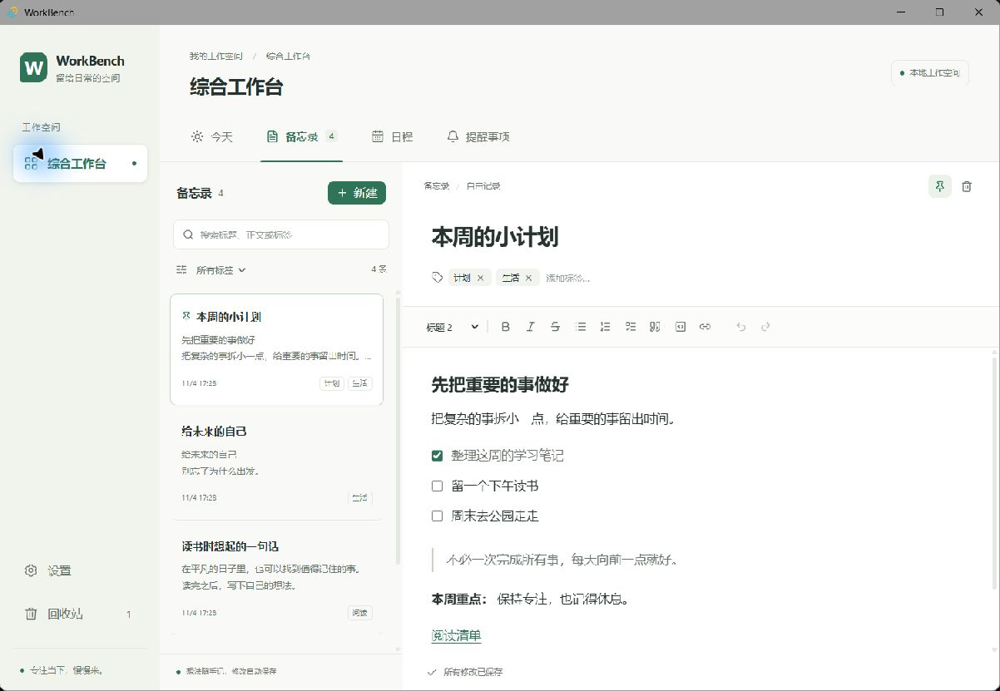

# WorkBench 工作台

WorkBench 是一个以本地数据为中心的模块化桌面工作台，使用 Tauri 2、React、TypeScript 和 Vite 构建。
项目先支持 Windows，内置综合工作台，后续按架构计划加入沙盒分工作台。

当前进入 **Phase 1：综合工作台**，已提供 SQLite 数据层、主框架、Tiptap 备忘录、月／周／日日程、日程提前提醒数据联动、主题设置和备忘录／日程回收站；今天、提醒事项暂为占位页，通知调度与 SDK、插件运行时将在后续阶段实现。
项目的唯一设计依据是 [ARCHITECTURE.md](ARCHITECTURE.md)，开发规则见 [AGENTS.md](AGENTS.md)。



## 目录

```text
apps/desktop/          Tauri 2 桌面主程序（React + TypeScript + Vite）
packages/sdk/          @workbench/sdk，分工作台访问宿主能力的入口
packages/ui/           @workbench/ui，共享组件与主题
packages/manifest/     @workbench/manifest，manifest 类型与校验
workbenches/general/  @workbench/general，内置综合工作台
docs/                 后续开发文档
```

## Windows 开发环境

- Git、Node.js 24 LTS、pnpm 11.25.0。
- Rust stable，使用 MSVC 工具链，版本至少为 1.90。
- Visual Studio C++ Build Tools，包含“使用 C++ 的桌面开发”工作负载及 Windows SDK。
- WebView2 Runtime。
- GitHub CLI（用于推送后的 PR 管理）。

系统依赖安装说明见 [Tauri 官方前置条件](https://v2.tauri.app/start/prerequisites/)。
桌面端基于 [Tauri 官方模板](https://v2.tauri.app/start/create-project/) 的 `react-ts` 模板生成。

## 安装与运行

以下命令均在仓库根目录运行：

```powershell
pnpm install --frozen-lockfile
pnpm dev
```

也可以直接启动桌面端：

```powershell
pnpm --filter desktop tauri dev
```

首次启动会下载 Rust 依赖并编译。成功后应打开标题为 **WorkBench** 的窗口，默认进入综合工作台的“今天”页签。
开发服务器使用 `http://localhost:1420`。结束开发时关闭应用窗口，并在终端按 `Ctrl+C`。

## 开发命令

| 命令                                            | 用途                                         |
| ----------------------------------------------- | -------------------------------------------- |
| `pnpm dev`                                      | 启动 Tauri 桌面开发模式                      |
| `pnpm build`                                    | 构建桌面应用及默认安装包                     |
| `pnpm lint`                                     | 检查 ESLint 规则，禁止显式 `any`             |
| `pnpm typecheck`                                | 检查桌面端和所有工作区的严格 TypeScript 类型 |
| `pnpm test`                                     | 运行 Vitest                                  |
| `pnpm format`                                   | 格式化代码与新增文档，统一 LF 换行           |
| `pnpm --filter desktop build`                   | 仅构建桌面端前端资源                         |
| `pnpm --filter desktop tauri build --no-bundle` | 编译桌面程序，不生成安装包                   |

`pnpm test` 包含数据仓库、回收站、重复日程、Markdown 往返、数据接口和自动保存测试。
新增逻辑必须同时添加 Vitest 单元测试。现有 `ARCHITECTURE.md`、`AGENTS.md` 和 `.gitignore` 不由格式化命令改写。

## 验证与手动测试

```powershell
pnpm install --frozen-lockfile
pnpm lint
pnpm typecheck
pnpm test
pnpm --filter desktop tauri build --no-bundle
pnpm --filter desktop tauri dev
```

1. 确认命令没有报错，桌面窗口标题为 WorkBench，中文页面能正常显示。
2. 按 [备忘录手动验证步骤](docs/memos-verification.md) 检查编辑、自动保存、主题和回收站；截图说明也在该文档中。
3. 按 [日程手动验证步骤](docs/calendar-verification.md) 检查三种视图、编辑／拖动／缩放、重复范围、默认提醒及日程恢复。该文档包含 FullCalendar 的选型与 MIT 许可证说明。
4. 关闭窗口并在终端按 `Ctrl+C`，确认开发进程退出。

GitHub Actions 会在 `windows-latest` 上检查安装、lint、类型、测试和桌面编译。

## 参与开发与许可证

分支、提交和 PR 流程见 [CONTRIBUTING.md](CONTRIBUTING.md)。其他分工作台只能通过 `@workbench/sdk` 访问宿主能力；Phase 1 内置综合工作台的数据入口统一放在 `api.ts`，后续迁移至 SDK。

本项目使用 [MIT 许可证](LICENSE)，作者 Royce Lee，2026。
