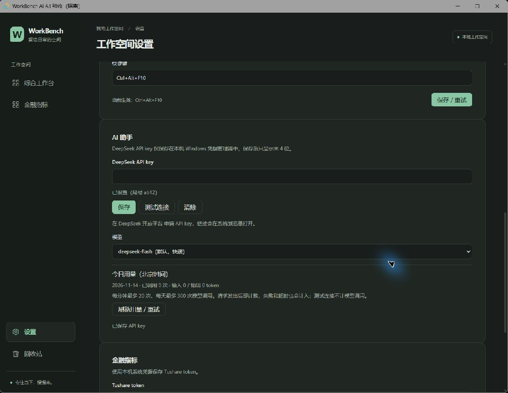
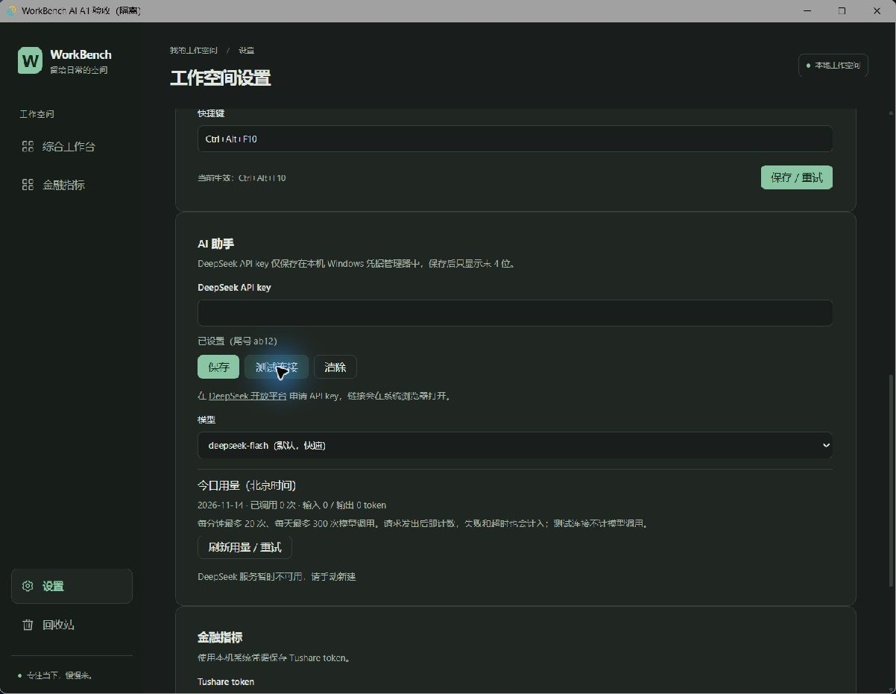
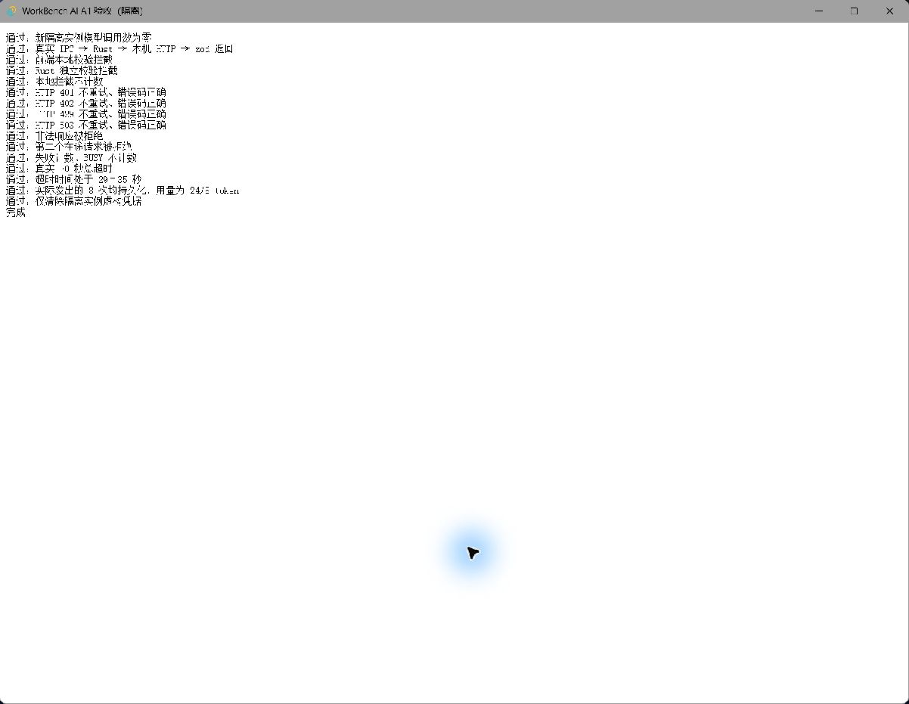

# AI A1 客户端与密钥验收

日期：2026-11-14。范围仅为 A1：Rust DeepSeek 客户端、凭据、用量文件、TypeScript 协议与设置页。没有新增对话页、AI 快捷键或业务操作，没有迁移或修改业务表。

## 已确认的边界

- 密钥使用 `<identifier>.ai` / `deepseek` 系统凭据；主窗口独占 AI 命令。`quick-create` 未获得权限。主窗口每个命令仍检查原生窗口标签。
- 输入保存时，完整 key 必须短暂经过密码框和 `ai_key_set` 的 IPC 参数；输入立即清空，不提供完整 key 的读取接口。不能承诺开发者工具无法观察用户刚输入的保存参数。保存后的状态仅含尾号、是否设置与非敏感用量；聊天 IPC 不携带 key，由 Rust 添加鉴权头。不主动打印输入、保存参数或原生错误正文。
- 请求只发固定 DeepSeek 地址，不跟随重定向、不自动重试。仅 debug 编译允许回环 HTTP 地址；release 的编译分支不读取该环境变量。CSP 保持原样。
- 请求交给 HTTP 传输前先持久化计数，失败、连接错误、超时仍计数；本地参数、密钥、配置、BUSY、限额或持久化校验拦截不计。写盘失败停止发送。异常退出发生在落盘和实际发送之间时，可能保守多计一次，避免少记付费调用。
- `ai-usage.json` 在应用数据目录独立保存，使用北京时间自然日、固定分钟窗口；每天 300 次、每分钟 20 次。文件损坏恢复到当日 150 次和当前分钟 10 次，并记录固定警告；系统时间回拨不清零。用量不存 `workbench.db` / `settings`。
- 日志仅记录时间、白名单模型、HTTP 状态、耗时、token 和本地错误码；达到 1 MiB 后轮转，只保留一份旧日志。不会写请求、回复正文或鉴权头。
- 平台链接复用现有 shell 插件，由仅 main 可用的辅助命令打开固定官方 URL，不接受任意地址。

## 官方协议核对

2026-11-14 查阅以下官方页面：

- [模型与价格](https://api-docs.deepseek.com/quick_start/pricing/)和[模型列表](https://api-docs.deepseek.com/api/list-models/)仍列出 `deepseek-flash` 与 `deepseek-v4-pro`，与白名单一致。
- [Chat Completions](https://api-docs.deepseek.com/api/create-chat-completion/)支持 `thinking.type = disabled`、非流式响应和工具参数；[非思考模式工具示例](https://api-docs.deepseek.com/guides/tool_calls/)展示了 assistant 工具调用、tool 结果和下一次请求的组合，不需要回传思考正文。
- [错误码](https://api-docs.deepseek.com/quick_start/error_codes/)说明 401 / 402 / 429 / 500 / 503 含义，与本地映射一致。400 / 422 / 非法响应统一为 `BAD_RESPONSE`。不直接转发上游说明。
- `GET /models` 是已公开的模型列表接口，用于测试凭据，不发推理请求，也不计入本地模型调用数。公开文档未找到单独明确的“该接口免费”声明；价格页按模型 token 计费，因此不产生推理费用是依据文档的推断，并非本轮真实账单实测。真实服务鉴权与账单观察留到 A5，由用户自行填 key。
- 锁文件原已包含 reqwest 0.13.5。本次提升为直接依赖，仅指定 `json`、`rustls`，关闭默认特性；0.13 的特性名是 `rustls`，不是旧版的 `rustls-tls`。没有增加第二个 reqwest 版本，也没有 native-tls。新增的传递依赖由 rustls 引入，没有额外日期或测试框架依赖。

## 自动检查

在仓库根目录运行：

```powershell
pnpm lint
pnpm typecheck
pnpm test
pnpm exec prettier . --check
cargo fmt --manifest-path apps/desktop/src-tauri/Cargo.toml --check
cargo test --locked --manifest-path apps/desktop/src-tauri/Cargo.toml --lib
pnpm --filter desktop build
```

本轮 lint、全部工作区类型检查、Prettier、Rust 格式检查通过；前端测试 224 项通过，其中 A1 新增 31 项；全量 Rust 库测试 20 项通过，其中 AI 新增 14 项。`pnpm --filter desktop build` 成功（Vite 仍提示部分产物超过 500 kB，不影响构建）。Tauri dev 已用独立配置实际启动并完成下述检查。

覆盖内容：请求构造与体积限制、工具消息、模型白名单、规范化响应、全部错误码与脱敏、BUSY、无重试、重定向拒绝、超时、响应体上限、凭据格式/尾号/Debug、主窗口权限、用量落盘/重启/损坏/分钟及北京午夜边界、设置页保存和清除、模型持久化、密码框清空与重复提交。

## 准备独立实例

以下命令均在仓库根目录的 PowerShell 运行。只使用新建的隔离目录，不能换成正式版 identifier 或正式版数据路径。模拟凭据只是固定的虚构字符串，不要输入真实 key。

终端一启动本机模拟服务：

```powershell
node apps/desktop/tests/ai-mock-server.mjs dist/ai-a1-check
```

终端二准备并启动隔离实例；目录存在时停止，复测时应更换目录和 identifier，并相应调整测试夹具的隔离断言：

```powershell
$aiCheckRoot = Join-Path (Get-Location) 'dist/ai-a1-check'
if (Test-Path -LiteralPath (Join-Path $aiCheckRoot 'app')) {
  throw '隔离数据目录已存在，请使用新的验收目录'
}
$aiCheckApp = (New-Item -ItemType Directory -Path (Join-Path $aiCheckRoot 'app')).FullName
@{
  identifier = 'com.royce.workbench.ai-a1-check'
  app = @{
    appDirectoriesOverride = $aiCheckApp
    windows = @(@{
      label = 'main'
      title = 'WorkBench AI A1 验收（隔离）'
      width = 1200
      height = 900
      minWidth = 900
      minHeight = 600
    })
  }
} | ConvertTo-Json -Depth 8 | Set-Content (Join-Path $aiCheckRoot 'tauri.json') -Encoding utf8
$env:WORKBENCH_AI_BASE_URL = 'http://127.0.0.1:18926'
pnpm --filter desktop tauri dev --config ../../dist/ai-a1-check/tauri.json
```

两个进程须处于相同的宿主网络环境。首次联调发现沙盒服务与宿主桌面进程之间的回环隔离会产生连接超时；两者改为同一环境后正常。不需要关闭防火墙、修改系统安全设置或放宽应用 CSP。

## 用户可照做的界面步骤

1. 打开隔离实例的设置，将快速新建快捷键改为未被正式版使用的组合。本轮用 `Ctrl+Alt+F10`，确认显示为当前生效。
2. 找到“AI 助手”，填写测试代码中的虚构凭据 `sk-fake-workbench-test-ab12`，点击保存。密码框清空，显示“已设置（尾号 ab12）”。不要在这里填真实 key。
3. 点击“测试连接”，显示“连接正常”；今日调用数仍为 0。切换模型并重新打开设置，确认保存成功。
4. 在终端改变模拟场景，再点击测试连接；每次等结果出现后再切换下一场景：

   ```powershell
   '{"status":401}' | Set-Content dist/ai-a1-check/scenario.json -Encoding utf8
   # 分别将状态替换为 402、429、503。
   '{"status":200,"delay_ms":31000}' | Set-Content dist/ai-a1-check/scenario.json -Encoding utf8
   # 恢复正常：
   '{"status":200}' | Set-Content dist/ai-a1-check/scenario.json -Encoding utf8
   ```

   对应应显示无效 key、余额不足、请求频繁、服务暂不可用、约 30 秒超时；处理期间按钮禁用，不自行重试。

5. 查看 Windows 控制面板 → 用户账户 → 凭据管理器 → Windows 凭据 → 普通凭据，仅查看隔离条目 `com.royce.workbench.ai-a1-check.ai`，账户应为 `deepseek`。不要展开正式版条目，也不需要显示密码。Codex 本轮没有自动操作凭据管理器界面。
6. 点击隔离实例的“清除”，显示尚未设置；重启后保持未设置。非敏感条目核对可用 `cmdkey /list:com.royce.workbench.ai-a1-check.ai`，只列该隔离服务的元数据。





## 真实 IPC 自动验收夹具

`apps/desktop/tests/ai-native-check.html` 仅在手动指定 devUrl 后加载，不在产品入口中引用。夹具先断言 identifier 必须等于 `com.royce.workbench.ai-a1-check`；使用虚构 key、实际 Tauri 命令、实际 Rust HTTP 和本机服务。禁止将其指向正式版配置。

正常界面验收后，停止隔离 dev 进程，再在同一隔离配置中设置：

```powershell
'{"status":200,"scripted":true}' | Set-Content dist/ai-a1-check/scenario.json -Encoding utf8
$aiConfigPath = Join-Path (Get-Location) 'dist/ai-a1-check/tauri.json'
$aiConfig = Get-Content -Raw $aiConfigPath | ConvertFrom-Json
$aiConfig | Add-Member -NotePropertyName build -NotePropertyValue @{
  devUrl = 'http://localhost:1420/tests/ai-native-check.html'
} -Force
$aiConfig | ConvertTo-Json -Depth 8 | Set-Content $aiConfigPath -Encoding utf8
pnpm --filter desktop tauri dev --config ../../dist/ai-a1-check/tauri.json
```

初始调用数必须为 0，约 30 秒后显示全部断言通过。依次验证成功返回、前端和 Rust 校验、401/402/429/503、非法响应、同时请求、真实超时、调用计数、token 和清除凭据。不会读写日程、提醒或备忘录。

停止进程，将 devUrl 改为 `http://localhost:1420/tests/ai-native-check.html?stage=resume` 后重启，应显示恢复 8 次，且凭据仍未设置。再次停止，将独立的 `app/ai-usage.json` 改为 `broken`，devUrl 改为 `?stage=corrupt` 后重启，应显示 150 次，并在隔离 `ai-client.log` 中出现 `usage_recovered calls=150`。



## 本轮实测记录

| 检查                       | 结果                                                                                                                         |
| -------------------------- | ---------------------------------------------------------------------------------------------------------------------------- |
| 正常产品界面与独立数据路径 | 通过；独立标题、identifier、仓库忽略目录，未操作正式版窗口或数据                                                             |
| 独立快捷键                 | 通过；设置为 `Ctrl+Alt+F10` 后错误条消失                                                                                     |
| 保存、尾号、清空输入       | 通过；真实 Windows 凭据后端，界面仅显示 `ab12`                                                                               |
| 模拟连接与 401/402/429/503 | 通过；真实设置页中文提示，连接测试未增加模型调用数                                                                           |
| 30 秒总超时                | 通过；设置页及 IPC 夹具均出现 TIMEOUT，日志分别约 30001 ms                                                                   |
| 真实 IPC 客户端            | 通过；8 次 POST，失败和超时计数，本地校验与 BUSY 不计，成功回复累计 24/8 token                                               |
| 重启恢复                   | 通过；保留 8 次，清除后的凭据未出现                                                                                          |
| 损坏文件保守恢复           | 通过；重启显示 150 次、分钟 10 次，并写 `usage_recovered calls=150`                                                          |
| 凭据清理                   | 通过；仅查询隔离服务，`cmdkey /list` 为 NONE                                                                                 |
| 数据与日志脱敏             | 通过；停止隔离进程后扫描隔离数据库及 WAL、用量、应用日志，未发现虚构 key；模拟服务只记录字段名与统计，不扫描或打开正式版文件 |

本轮不使用真实 DeepSeek key，不验证真实模型解析准确率或账单。开发者工具新进程的自动化授权曾超时，因此采用上述专用 IPC 夹具补充验证；没有把未观察到的 DevTools Network 面板内容记为通过。

全部隔离配置、数据库、用量文件、服务请求元数据与临时结果留在 Git 忽略目录，只有代码、规格、本文和无密钥截图进入提交。验收后停止本轮 dev 与模拟服务；虚构系统凭据已清除。
