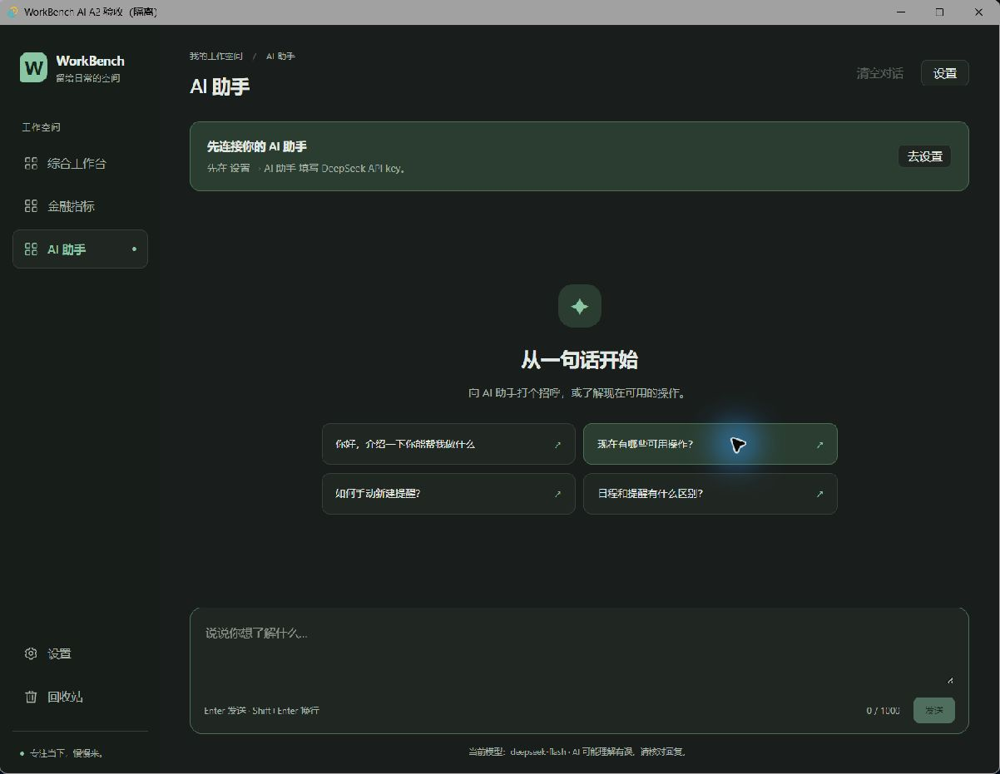
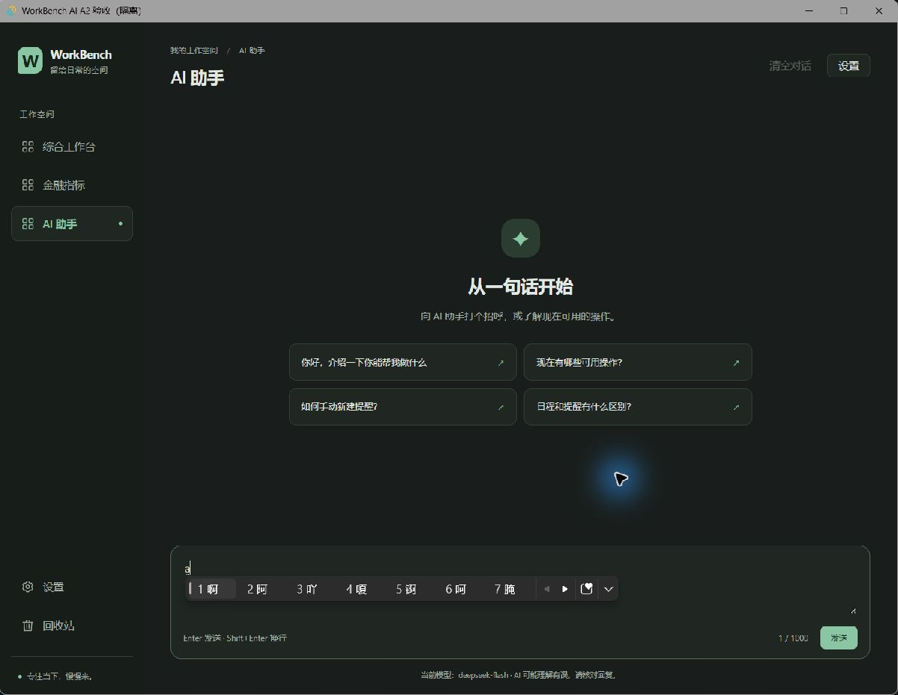
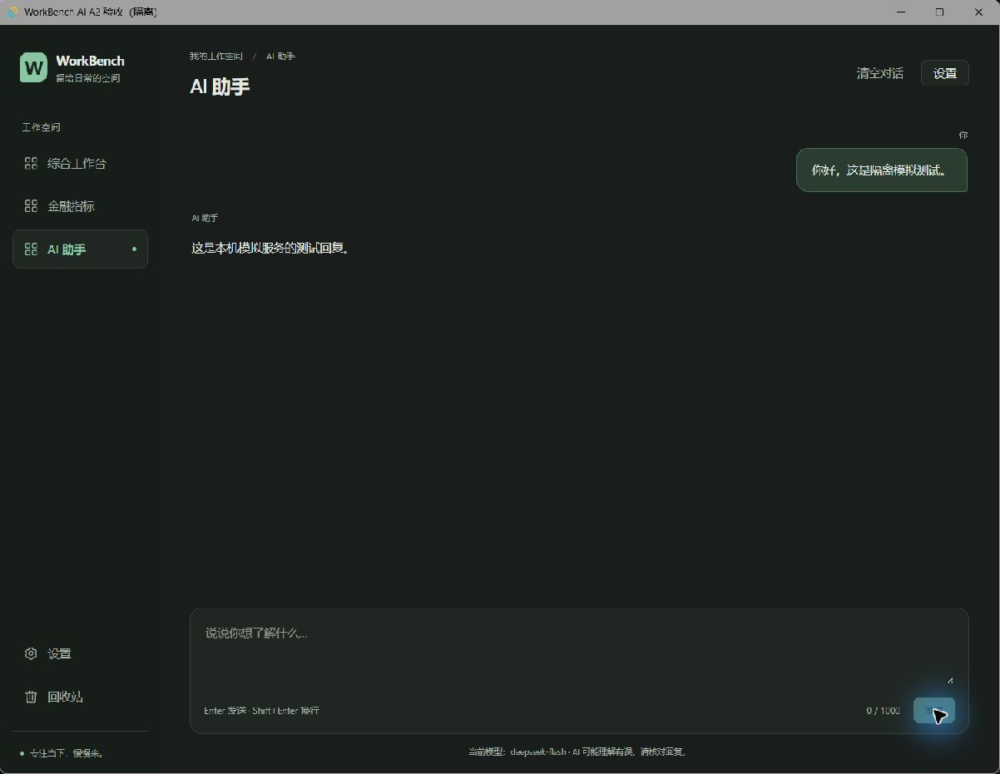

# AI A2 工作台框架验收

日期：2026-11-15。范围为 A2：三个内置工作台切换、AI 对话页、操作登记与编排框架、AI 全局快捷键及设置。正式操作登记表为空，本阶段模型只能文字回复，不会创建、查询、修改或删除业务数据；对话、输入草稿和短引用仅留在内存，没有对话持久化或业务表迁移。

## 自动检查

在仓库根目录运行：

```powershell
pnpm lint
pnpm typecheck
pnpm test
pnpm exec prettier . --check
pnpm --filter desktop build
cargo fmt --manifest-path apps/desktop/src-tauri/Cargo.toml --check
cargo test --locked --manifest-path apps/desktop/src-tauri/Cargo.toml --lib
```

本轮 lint、工作区类型检查、Prettier、Rust 格式检查通过，TypeScript 测试 294 项、Rust 库测试 25 项通过。桌面前端构建成功，AI 页面生成独立的 `AiWorkbench` 懒加载产物（18.76 kB）；Vite 仍有既有的部分产物超过 500 kB 提示。`tauri dev` 已按下文的独立配置实际启动。

自动测试覆盖 prompt 的时间、功能与“数据不是指令”规则，本地时间转换，登记检查与工具生成，短引用过期与类型检查，MockLlmClient 的读取循环、三轮上限、每轮工具数量限制、`tool_call_id` 对应、写入提案停止、参数错误与历史裁剪；假读取操作只在测试中登记。另覆盖对话草稿、纯文本显示、无 key 引导、错误入口、快捷键互斥与回滚，以及工作台切换、通知和托盘的回归。

真实 DeepSeek 模型的理解准确率、费用和真实业务操作不属于本轮验收，留到后续阶段。

## 准备隔离实例

以下命令均在仓库根目录的 PowerShell 运行。本轮使用 identifier `com.royce.workbench.ai-a2-check`，数据目录 `dist/ai-a2-check/app`，窗口标题“WorkBench AI A2 验收（隔离）”，大小 1200 × 900。只使用模拟服务和虚构凭据，不输入真实 key。

终端一启动本机模拟服务，显式指定端口 18927：

```powershell
node apps/desktop/tests/ai-mock-server.mjs dist/ai-a2-check 18927
```

终端二准备并启动隔离实例。数据目录已存在时命令会停止；重新验收时请更换目录和 identifier，并同步修改两边命令，不能改成正式版 identifier 或正式版数据目录。

```powershell
$aiCheckRoot = Join-Path (Get-Location) 'dist/ai-a2-check'
if (Test-Path -LiteralPath (Join-Path $aiCheckRoot 'app')) {
  throw '隔离数据目录已存在，请使用新的验收目录和 identifier'
}
$aiCheckApp = (New-Item -ItemType Directory -Path (Join-Path $aiCheckRoot 'app')).FullName
@{
  identifier = 'com.royce.workbench.ai-a2-check'
  app = @{
    appDirectoriesOverride = $aiCheckApp
    windows = @(@{
      label = 'main'
      title = 'WorkBench AI A2 验收（隔离）'
      width = 1200
      height = 900
      minWidth = 900
      minHeight = 600
    })
  }
} | ConvertTo-Json -Depth 8 | Set-Content (Join-Path $aiCheckRoot 'tauri.json') -Encoding utf8
$env:WORKBENCH_AI_BASE_URL = 'http://127.0.0.1:18927'
pnpm --filter desktop tauri dev --config ../../dist/ai-a2-check/tauri.json
```

模拟服务和桌面进程需要位于同一宿主网络环境。此地址覆盖仅用于 debug 编译，不需要修改 CSP。虚构凭据使用 `sk-fake-workbench-test-ab12`；保存后界面只显示尾号 `ab12`。隔离凭据服务为 `com.royce.workbench.ai-a2-check.ai`，Windows 后端实际凭据目标为 `deepseek.com.royce.workbench.ai-a2-check.ai`，账户为 `deepseek`；只用服务名查询 `cmdkey /list` 不能证明该凭据不存在。

## 用户可照做的步骤

1. 核对隔离窗口标题。打开“设置”，把快速新建快捷键改为 `Ctrl+Alt+F10`，避免与正式版默认快捷键相同；确认“当前生效”已更新。AI 助手保留默认 `Ctrl+Alt+Space`，确认注册成功。
2. 点击侧栏“AI 助手”。未设置 key 时应看到“先连接你的 AI 助手”引导；点击“去设置”，回到综合工作台设置页并定位 AI 分区。填写上述虚构凭据并保存，密码框清空，只显示尾号。
3. 回到 AI 助手，输入一句测试文字并发送，应显示“正在理解…”和发送中状态，完成后出现“这是本机模拟服务的测试回复。”。切到综合、金融再切回 AI，当前进程内对话仍在。回复按纯文本显示，不执行 HTML 或 Markdown 内容。
4. 在 AI 快捷键输入框填写 `Ctrl+Alt+F10` 并保存，应明确提示“与快速新建快捷键冲突”。界面仍显示原来的 `Ctrl+Alt+Space` 生效；失败组合不会覆盖已保存配置。
5. 按 `Alt+F4` 把隔离主窗口隐藏到托盘，再选中资源管理器等其他窗口，按 `Ctrl+Alt+Space`。应重新显示主窗口、切到 AI 助手并直接聚焦输入框。不要点击输入框，直接键入 `a`；中文输入法启用时应看到组合输入和候选框，按 `Esc` 可取消组合输入。再次按 AI 快捷键只重新聚焦，不清空对话或发送消息。
6. 按下文分别切换模拟场景，每次回到 AI 助手发送一句新测试文字，等本次结果出现后再切换下一场景。错误卡片应为中文，并提供适用的“去设置”“DeepSeek 开放平台”“手动新建”入口，不显示模拟服务的原始错误正文。
7. 用延时场景发送后，在等待时编辑下一句草稿，再次按 AI 快捷键；草稿应保留，仍只有原来那一笔 POST，不能重复发送。`Enter` 发送、`Shift+Enter` 换行；中文候选确认期间按 Enter 不能误发。
8. 在综合工作台设置切换浅色、深色，分别查看 AI 页面、引导和错误卡片。测试结束后在隔离实例的 AI 设置点击“清除”，再退出隔离应用，并在两个终端按 `Ctrl+C` 停止 dev 和模拟服务。不要操作正式版的凭据或数据目录。

## 模拟回复与错误

在第三个终端写入场景文件即可影响下一次请求；每条命令均在仓库根目录执行。它们不会访问真实 DeepSeek 服务。

| 场景             | 写入命令                                                                                         | 预期界面                                   |
| ---------------- | ------------------------------------------------------------------------------------------------ | ------------------------------------------ |
| 正常回复         | `'{"status":200}' \| Set-Content dist/ai-a2-check/scenario.json -Encoding utf8`                  | 纯文字回复                                 |
| 401              | `'{"status":401}' \| Set-Content dist/ai-a2-check/scenario.json -Encoding utf8`                  | API key 无效，提供“去设置”                 |
| 402              | `'{"status":402}' \| Set-Content dist/ai-a2-check/scenario.json -Encoding utf8`                  | 余额不足，提供“DeepSeek 开放平台”          |
| 429              | `'{"status":429}' \| Set-Content dist/ai-a2-check/scenario.json -Encoding utf8`                  | 请求太频繁                                 |
| 503              | `'{"status":503}' \| Set-Content dist/ai-a2-check/scenario.json -Encoding utf8`                  | 服务暂时不可用                             |
| 非法响应         | `'{"status":200,"bad":true}' \| Set-Content dist/ai-a2-check/scenario.json -Encoding utf8`       | 内容无法解析，提供手动入口                 |
| 超时与等待中草稿 | `'{"status":200,"delay_ms":31000}' \| Set-Content dist/ai-a2-check/scenario.json -Encoding utf8` | 等待期间可以编辑下一句；约 30 秒后显示超时 |

超时测试结束后恢复正常场景，再继续其他操作。平台按钮使用 A1 的固定官方链接能力；本轮只核对错误卡片上的入口，不要求登录或付费。

模拟服务只把字段名、角色和状态等非敏感请求元数据写入 `dist/ai-a2-check/requests.jsonl`，不写正文或 Authorization。本轮共观察到 7 次聊天 POST，全部没有 `tools` 字段，与正式登记表为空一致。调用数为 7，只有成功回复记录了输入 12、输出 4 token，其他失败没有 token。超时日志为 `TIMEOUT`、30001 ms。等待期间重复按快捷键没有增加 POST，没有自动重试。计数沿用 A1 的 Rust 客户端规则，不在前端重复计算。

## §18.3 第 3、4 条实测结果

| 技术点                         | 结果与证据                                                                                                                                                                                                     |
| ------------------------------ | -------------------------------------------------------------------------------------------------------------------------------------------------------------------------------------------------------------- |
| 托盘隐藏后快捷键能否唤起并聚焦 | 通过。按 `Alt+F4` 后，窗口清单中该隔离进程没有可见窗口；从资源管理器按 `Ctrl+Alt+Space` 后主窗口显示并切到 AI。没有点击输入框，直接键入 `a` 即在输入框出现组合输入与中文输入法候选，说明聚焦发生在页面挂载后。 |
| `Space` 写法与插件注册         | 通过。规范化写法为 `Ctrl+Alt+Space`，`tauri-plugin-global-shortcut` 注册成功。`Space` 仅允许与 `Ctrl+Alt` 或 `Ctrl+Shift` 组合，其他 Space 组合由本地校验拒绝。                                                |
| 中文输入法与快捷键冲突恢复     | 通过。开启中文输入法时快捷键仍正常唤起和聚焦；改成快速新建已占用的 `Ctrl+Alt+F10` 会提示冲突，原 Space 组合仍然有效。                                                                                          |

## 界面截图

无 key 引导（深色）：



从其他窗口呼出后直接输入，显示中文输入法候选（深色）：



正常模拟文字回复（深色）：



其他截图：

- [快捷键冲突（深色）](screenshots/ai-a2-shortcut-conflict-dark.jpg)
- [重启后无 key、空对话与空草稿（浅色）](screenshots/ai-a2-no-key-light.jpg)
- [无效 key（深色）](screenshots/ai-a2-key-error-dark.jpg)、[无效 key（浅色）](screenshots/ai-a2-key-error-light.jpg)
- [余额不足（浅色）](screenshots/ai-a2-balance-error-light.jpg)
- [请求频繁（浅色）](screenshots/ai-a2-rate-error-light.jpg)
- [上游服务错误（浅色）](screenshots/ai-a2-upstream-error-light.jpg)
- [非法响应（浅色）](screenshots/ai-a2-bad-response-light.jpg)
- [发送中编辑下一句草稿（浅色）](screenshots/ai-a2-pending-draft-light.jpg)
- [30 秒超时（浅色）](screenshots/ai-a2-timeout-light.jpg)

## 本轮实测记录

| 检查                                    | 当前结果                                                                        |
| --------------------------------------- | ------------------------------------------------------------------------------- |
| 独立 identifier、目录、标题与启动       | 通过；隔离 `tauri dev` 启动成功                                                 |
| 快捷键隐藏唤起、焦点、Space、中文输入法 | 通过，见上文 §18.3 实测                                                         |
| 无 key 引导及设置定位                   | 通过                                                                            |
| 模拟 200、401、402、429、503、非法响应  | 通过，已保存浅色及深色截图                                                      |
| 等待中编辑草稿与重复快捷键              | 通过；草稿保留，未增加 POST                                                     |
| 正式界面无业务工具                      | 通过；请求元数据均无 `tools` 字段                                               |
| 30 秒 TIMEOUT 卡片                      | 通过；日志 30001 ms，已保存浅色截图                                             |
| 错误卡片“手动新建”入口                  | 通过；进入综合工作台的新建提醒表单，未保存并按 Esc 关闭                         |
| 对话不持久化                            | 通过；重启同一隔离实例后，对话与输入草稿均为空，主题仍为浅色                    |
| 隔离凭据清理                            | 通过；仅清理 `deepseek.com.royce.workbench.ai-a2-check.ai`，指定目标查询为 NONE |
| 隔离进程清理                            | 通过；本轮 dev、模拟服务已停止，1420 / 18927 无监听                             |

隔离配置、数据库、用量文件和请求元数据均位于 Git 忽略目录；仅代码、本文和无真实密钥的截图进入提交。正式版数据与凭据不属于本轮操作范围。
