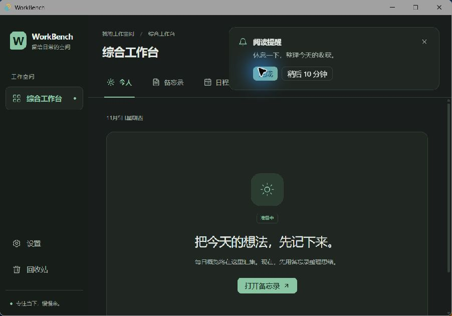
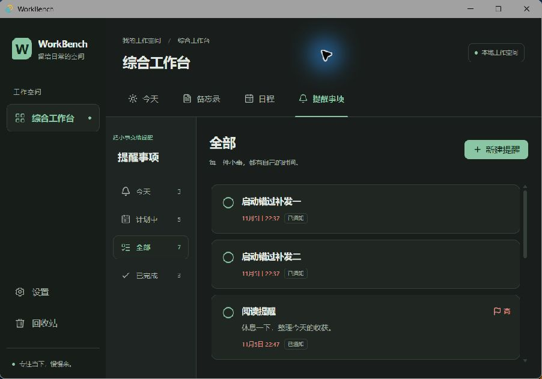

# 提醒、通知条与托盘验证

本次实现规格 §6、§7 中的提醒、托盘、自启，以及提醒回收站。今天页完整总览和全局快捷键留给 PR5。

## 自动检查

在仓库根目录执行：

```powershell
pnpm install --frozen-lockfile
pnpm lint
pnpm typecheck
pnpm test
pnpm exec prettier . --check
pnpm --filter desktop tauri dev
```

单测覆盖精确定时、30 秒轮询、并发防重复、停止清理、睡眠后补查、启动汇总、通知失败重试、重复 COUNT 固定起点、旧实例完成与贪睡、日程 EXDATE 与例外、数据事务、30 天清理边界、首次自启提示、分组排序和表单冲突。

## 手动步骤

1. 打开「提醒事项」，确认「今天 / 计划中 / 全部 / 已完成」四组。创建一个无时间待办，确认仅在「全部」出现；设置高优先级后检查标识，勾选后进入「已完成」。
2. 创建带到期时间和两行备注的提醒，到期设在约 1 分钟后。首次会询问开机自启，点「暂不」；再次创建带时间提醒或带提前提醒日程时不再提示。默认自启保持关闭。
3. 到点后检查右上角软件内通知条只显示标题和备注首行，提供「完成 / 稍后 10 分钟」。点击标题可定位到对应提醒；点击「完成」后通知条消失、提醒进入已完成组，之后不重复弹出。
4. 另一条到点后点击「稍后 10 分钟」，通知条应消失，提醒标记为稍后提醒。保持应用运行，10 分钟后再次显示；完成后不再贪睡。
5. 创建一条即将到期的提醒，关闭窗口。确认应用仍在托盘，到点先显示并聚焦主窗口，再弹出软件内通知条。只最小化窗口时也应恢复并聚焦。
6. 创建每天重复、共 3 次的提醒，先勾选完成，确认下一次出现；对另一实例等到触发，确认触发后推进下一次。通过较早实例的通知条完成或贪睡，不应再次推进未来实例。
7. 创建两条稍后到期的提醒，从托盘「退出」。等到两条都过期再重启，检查只出现一条「你有 2 条错过的提醒」软件内通知条；点击打开「今天」页。再重启不应重复补发。
8. 托盘菜单应有「打开 WorkBench / 新建提醒 / 退出」；双击图标打开，选择新建直接进入提醒表单，退出结束应用。关闭窗口前若正在编辑备忘录，应先完成保存。
9. 设置页检查开机自启初始关闭，开启后重新进入仍为开启；关闭后恢复。系统登录启动以隐藏到托盘方式运行。无需开启 Windows 系统通知。
10. 给日程设置提前提醒，在提醒页确认有日程图标，标题、备注、时间和重复均只读；优先级可改，完成及贪睡可用。日程改时间后旧通知操作应安全失败，不能改到新实例。
11. 删除普通提醒，在回收站「提醒事项」组恢复，检查内容与完成状态保留。删除关联日程后，恢复日程应一同恢复关联提醒；只恢复提醒时应提示先恢复日程。永久清空保留墓碑。30 天边界由内存 SQLite 假时间单测验证，勿修改个人数据库做测试。

## 实现与限制

- 通知全部在软件内显示，不使用 Windows 系统通知，不依赖 `tauri-plugin-notification`。通知条持续保留至操作或手动关闭；关闭通知条不等于完成提醒。
- 主窗口显示与聚焦成功后才发布通知条。展示失败时调度器释放本次通知回执，30 秒后重试；`notified_at` 与重复游标在同一条件事务中领取，避免并发重复。
- 新增迁移 `0002_reminder_scheduler.sql`，保留原迁移；每个提醒实例保存独立的通知、完成、贪睡与内容快照。删除、恢复与 30 天清理同父提醒联动。
- 应用退出或电脑关机时无法即时提醒；再次启动合并补发。自启默认关闭，只有用户主动开启才写系统自启项。

## 本次验证记录（2026-11-05）

- Windows 隔离应用标识与测试库下，真实到点触发；隐藏状态从不可见变为可见且获得焦点，随后出现通知条；备注仅显示首行。
- 实点通知条「完成」「稍后 10 分钟」；实际等待完整 10 分钟后再次出现通知，回执时间误差为毫秒级。
- 界面新建普通待办、重复完成推进下一天、日程生成提醒只读、回收站恢复原备注均已验证。
- 自启系统状态验证为关闭 → 开启 → 关闭，测试自启项已恢复关闭；首次提示只出现一次。
- 关闭开发进程跨过两条提醒的到期时间，重启后合并显示「你有 2 条错过的提醒」；再重启无重复通知。
- 正式无安装包构建通过。Windows 托盘菜单/双击和实际系统登录启动需按上面第 8、9 步人工验收，本次自动化无法操作托盘区域。

## 运行截图

以下为隔离测试库中的 Windows 实机画面，使用 900 × 600 最小窗口尺寸；截图临时置顶以避开其他应用遮挡，正式窗口设置保持不变。




