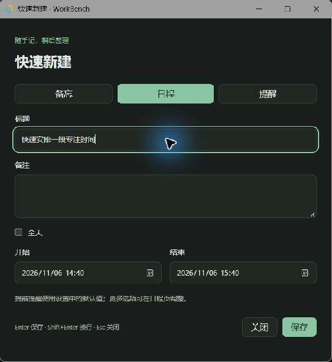

# 今天页与全局快速新建验证

本 PR 实现综合工作台规格 §3、§7 的今天汇总与全局快速新建。全部数据写入仍集中在 `workbenches/general/src/api.ts`，没有新增表或修改旧迁移。

## 自动检查

```powershell
pnpm install --frozen-lockfile
pnpm lint
pnpm typecheck
pnpm test
pnpm exec prettier . --check
pnpm --filter desktop tauri build --no-bundle
pnpm --filter desktop tauri dev
```

测试覆盖本地自然日的 23/25 小时边界、午夜/睡眠恢复刷新、重复例外与跨日日程、逾期和无时间待办筛选、置顶正文两行、完成旧实例的竞态、快捷键冲突及失败回滚、消息参数校验、三种快速保存、输入法/回车防重、Esc 与未保存草稿保留。

## 手动测试

1. 启动后默认进入「今天」，三个区块即使为空也保留。创建全天与跨日日程、今天和逾期提醒、无时间待办、置顶与普通备忘录，核对范围和顺序；置顶正文只显示渲染后的前两行。逾期提醒标红，无时间待办不出现在今天。
2. 点击日程进入对应日期并选中实例；重复日程的例外应选中例外。点击提醒打开该提醒详情；点击置顶备忘录进入编辑并清空不匹配的搜索/标签筛选。直接勾选提醒完成后，它从今天消失。
3. 保持应用跨午夜，或睡眠后次日恢复，日期和日程范围应自动更新。精确午夜与夏令时边界也有假时间单测，勿修改 Windows 时间做测试。
4. 按 Ctrl+Alt+N，应出现置顶、居中的独立「快速新建」窗口。分别选择备忘/日程/提醒，输入后 Enter 保存；Shift+Enter 换行，输入法选词回车不保存，Esc 收起。保存失败保留输入，保存中不会重复提交。空白窗口再次打开时更新默认日期，未完成草稿保留本次运行。
5. 关闭主窗口进入托盘，再从其他应用按快捷键，仍应呼出快速新建。保存备忘录后，主窗口列表可见；日程使用设置的默认提前提醒并同步关联提醒；不设时间的提醒保存为普通待办。
6. 设置页把快捷键改成例如 Ctrl+Alt+F10，确认旧组合失效、新组合可用。输入非法组合时提示；若被其他程序占用，提示冲突且原组合继续有效。关闭并重新启动后读取已保存组合。测试后可恢复 Ctrl+Alt+N。
7. 快速新建窗口不应有 SQL 或主窗口管理权限。主窗口 zod 校验拒绝未知类型、伪造来源和非法时间；这部分已有单测及真实 IPC 拒绝验证。
8. 回归备忘录编辑/自动保存/标签/搜索，日历月周日与拖动缩放，提醒/回收站原有流程。系统登录自启需在正式构建中验证；开发模式依赖 Vite，不能据此验收重新登录启动。

## 规格 §12 逐项验收记录

| 项             | 证据与结果                                                                                                                                                                                                                                                                           |
| -------------- | ------------------------------------------------------------------------------------------------------------------------------------------------------------------------------------------------------------------------------------------------------------------------------------ |
| 1 备忘录       | Markdown 全格式往返、保存/标签/搜索及回收站单测通过；实测快速备忘 Enter 保存、重启读取及今天页定位正确。                                                                                                                                                                             |
| 2 日程         | 月/周/日切换实测；拖动从 10:00–11:00 改为 11:00–12:00，再拖边缘延至 12:30，仓库读回一致。仅此次/此后/全部修改与删除以现有 SQLite 和纯函数测试验证。                                                                                                                                  |
| 3 提前提醒联动 | 重跑 event-reminders 与仓库/API 测试：生成、同步、删除、恢复关联提醒正确；快速日程同样读取默认提前量。                                                                                                                                                                               |
| 4 软件内通知   | 实测主窗口隐藏后到点显示并聚焦，通知只展示备注首行与两个按钮；回执晚于 due_at 22ms，触发约 4 秒后读到窗口可见且聚焦，点击完成后通知消失、重启仍完成。精确到点、去重、贪睡和重复推进假时间测试通过；完整 10 分钟实测沿用 [PR4 记录](reminders-verification.md)，本轮未重复等待。      |
| 5 托盘与补发   | 启动合并补发、重启防重单测通过；托盘三项菜单/双击按手动步骤人工验收，未把未操作的菜单标为通过。                                                                                                                                                                                      |
| 6 自启         | 隔离测试应用实际读取默认关闭；快速日程触发首次提示，点击「暂不」后仍关闭。只提示一次的 API/仓库测试通过。实际 Windows 重新登录启动仍需正式构建人工验收。                                                                                                                             |
| 7 全局快速新建 | 实测主窗口隐藏时 Ctrl+Alt+N 呼出置顶居中窗口，Esc 收起且主窗口仍隐藏；三种类型 Enter 保存成功，备忘同步主列表、日程同步提前 10 分钟提醒、无时间提醒作为待办。设置改为 Ctrl+Alt+F10 后旧组合失效、新组合可用；占用 F11 后界面提示冲突，F10 与数据库值均保留；恢复默认后重启注册成功。 |
| 8 回收站       | 软删除/恢复/清空及 30 天边界、保留墓碑的 SQLite 测试通过，未改动个人数据库。                                                                                                                                                                                                         |
| 9 今天         | 三个空状态、有数据时的全天/例外/逾期/置顶两行及三类定位实测正确；直接完成后移出总览。自然跨日后日期从 11/5 更新至 11/6，精确午夜和 DST 另有单测。                                                                                                                                    |
| 10 工程质量    | 仓库、重复规则、调度器、回收站、Markdown 及新增功能 Vitest 通过；lint、typecheck、Prettier、正式构建与 CI 结果见 PR。                                                                                                                                                                |

## 窗口与权限设计

- 使用 Tauri 官方 global-shortcut 插件，仅主窗口可注册/注销快捷键。新组合注册并写入 settings 成功后才释放旧组合，失败回滚并提示。
- 快速窗口只能提交消息、监听响应、隐藏自身；真实 IPC 检查已确认 SQL select、事务执行、读取主窗口队列、确认主窗口请求均被拒绝。
- Rust 校验原生窗口标签、长度及队列数量，并对同一请求 ID 去重；主窗口用 zod 严格校验，再调用 api.ts。响应只返回必要的偏好或新记录 ID。
- 新增备忘录只追加到主窗口状态，保留主窗口当前未保存输入。日程与提醒页监听数据变化，快速保存后同步更新。

## 截图

均使用独立测试库；空状态截图采集于 2026-11-05，汇总和快速新建截图采集于 2026-11-06。



